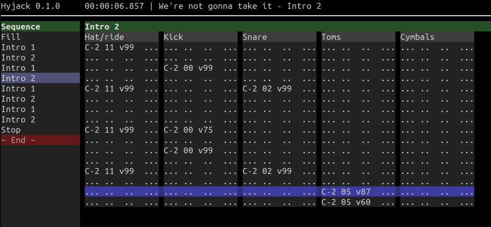
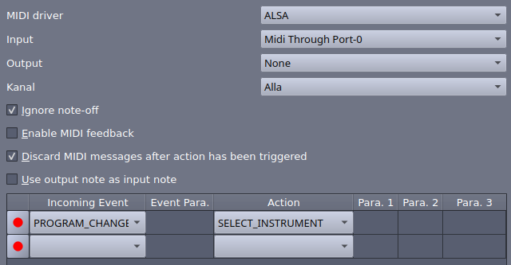
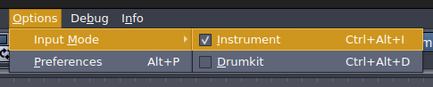

# Hyjack



Hyjack is a program for creating and playing music. It runs in the terminal and is operated entirely using the keyboard.

The UI is inspired by traditional [music trackers](https://en.wikipedia.org/wiki/Music_tracker), although it is not really a tracker under the surface. Playback relies on an external software synthesizer controlled via MIDI.

**NOTE:** *Hyjack is currently a work in progress, and many features needed for a complete editing workflow are not yet implemented.*


## A front end for Hydrogen

The motivation behind Hyjack is quite specific: to provide an efficient, keyboard-centric interface to the [Hydrogen drum machine](http://www.hydrogen-music.org/). I really like Hydrogen as an open-source, high-quality drum machine, but I prefer the editing experience of tracker programs.

My intended workflow is as follows:

  1. Edit drum (and bass) patterns in Hyjack.
  2. Enjoy live playback in Hydrogen via MIDI.
  3. When done: Convert the song to a Hydrogen song file and render an audio file in Hydrogen.

(Step (3) is still future work.)


## Hydrogen setup

This section explains how to set up Hydrogen for use with Hyjack.

Start by opening up Hydrogen's MIDI settings and check that a suitable input port is selected. The following settings have been tested to work well on Hydrogen 1.2.4 and 1.2.6 (Ubuntu 24.04).



You also need to ensure that the Input Mode is set to "Instrument". This setting is found in the Options menu.



Next, create a new song and load a drum kit. Adjust mixer settings as needed.


## Example

Start Hydrogen and load the file [GMRockKit_template.h2song](./examples/GMRockKit_template.h2song). This is an empty song with the drum kit GMRockKit loaded.

Next, start Hyjack with the file [were_not_gonna_take_it.json](./examples/were_not_gonna_take_it.json):

```bash
cargo run --bin hyjack examples/were_not_gonna_take_it.json
```

You should now see a prompt that looks something like this:

```
MIDI output:
  0: Silent playback
  1: Midi Through:Midi Through Port-0 14:0
  2: Hydrogen:Hydrogen Midi-In 128:0
Select output:
█
```

Select the Hydrogen MIDI input option.

The Hyjack UI starts up, and you can press `Space` to start playing.


## Creating a new song

An easy way to start a new song with GMRockKit is to copy the template file and start Hyjack with it:

```bash
cp ./examples/GMRockKit_template.json my_song.json
cargo run --bin hyjack my_song.json
```

[GMRockKit_template.json](./examples/GMRockKit_template.json) is an empty song configured for the GMRockKit drum kit.

You can also generate a new empty Hyjack song from any Hydrogen song:

```bash
cargo run --bin hydrogen-to-hyjack examples/GMRockKit_template.h2song > my_song.json
cargo run --bin hyjack my_song.json
```

This creates an empty Hyjack song file with song name, BPM and instruments from the Hydrogen song (see [Layered velocity boundaries](#layered-velocity)). The generated file has a single track. You may want add tracks by changing

```json
  "track_titles": [
    "Track 1"
  ],
```

to something like this:

```json
  "track_titles": [
    "Hat/ride",
    "Kick",
    "Snare",
    "Toms",
    "Cymbals"
  ],
```


## Keyboard controls

Some of the keyboard shortcuts (e.g. `Ctrl+Enter`) only work with the [Kitty keyboard control](https://blessed.readthedocs.io/en/latest/keyboard_kitty.html), which some traditional terminal emulators may not support.

### Universal

  * `Space` – Start/stop playback
  * `Ctrl+s` – Save the song to file
  * `Ctrl+q` – Quit the application

### Pattern panel

The two upper letter rows on the keyboard correspond to notes in the following way:

```
C  C# D  D# E  F  F# G  G# A  A# B
——————————————————————————————————
   w     e        t     y     u
a     s     d  f     g     h     j
```

Pressing one of these keys when the note column is focused will insert the corresponding note.

Instrument number and velocity can be set using the number keys.

Editing:

  * `Delete` – Remove the current note
  * `Enter` – Edit the focused pattern element. Enters a mode with the following controls:
      - `Up`/`Down` – Increase/decrease value of the focused element
      - `PgUp`/`PgDown` – Increase/decrease value by a larger amount
      - `Enter`/`Esc` – Exit edit mode
      - `Ctrl+Enter` – Copy this note's attributes (octave, velocity and instrument) to the editor settings

Navigation:

  * `Up`/`Down`/`Left`/`Right` – Navigate to previous/next row/column in the pattern grid
  * `Ctrl+Up`/`Ctrl+Down`/`Ctrl+Left`/`Ctrl+Right` – Scroll pattern up/down/left/right
  * `Tab`/`Shift+Tab` – Navigate to the next/previous track in the same column, or the last/first column at the pattern boundary
  * `PgUp`/`PgDown` – Navigate to the first/last row of the current pattern, then previous/next pattern
  * `Home`/`End` – Navigate to the first/last column of the current pattern row
  * `Ctrl+Home`/`Ctrl+End` – Navigate to the first row of the song/last row of the song or pool
  * `F2` – Rename pattern
  * `F3` – Switch to sequence panel
  * `Ctrl+Ins` – Insert a new pattern using the song's pattern defaults
  * `z`/`x`/`c`/`v` – Switch focus to editor's octave/velocity/step/instrument setting

### Sequence panel

  * `Up`/`Down` – Navigate to previous/next pattern title
  * `PgUp`/`PgDown` – Navigate to the previous/next page in the sequence
  * `Home`/`End` – Navigate to the first/last title in the sequence
  * `Ctrl+Up`/`Ctrl+Down` – Move current title up/down in the sequence list
  * `D` – Duplicate current title in the sequence list
  * `Ctrl+D` – Duplicate pattern
  * `Ctrl+Ins` – Insert a new pattern using the song's pattern defaults
  * `Delete` – Remove current title (moves to pool if it is the only reference)
  * `F2` – Rename pattern
  * `F4`/`Enter` – Switch to pattern panel

### Editor settings

  * `Up`/`Down` – Increase/decrease value of focused setting
  * `PgUp`/`PgDown` – Increase/decrease value by larger amount
  * `Left`/`Right` – Navigate to previous/next setting within the editor settings
  * `Home`/`End` – Set value to minimum/maximum
  * `z`/`x`/`c`/`v` – Navigate to octave/velocity/step/instrument setting
  * `Enter`/`Esc` – Exit editor settings

### Player


## Layered velocity

Hyjack represents note velocity using a number from 0 to 99. This number is converted to the range 0-127 in the MIDI back end.

Hydrogen instruments use velocity layers to allow different sets of samples to be triggered depending on the velocity of the note. Additionally, each instrument has an "Apply velocity" toggle that determines whether the sample should be scaled down according to the note's velocity.

When "Apply velocity" is enabled, the instrument can be seen as supporting the full range of note velocities. Then it makes sense to use the full range 0-99 in Hyjack as well.

### Layer blindness

However, when "Apply velocity" is disabled, the velocity range is effectively limited to the number of layers. Let's say we have an instrument with 4 layers (Hydrogen represents velocities as the range 0.0-1.0):

  * Layer 1: 0.0 - 0.2
  * Layer 2: 0.2 - 0.4
  * Layer 3: 0.4 - 0.8
  * Layer 4: 0.8 - 1.0

It is possible to still use the 0-99 range in Hyjack and let Hydrogen do the mapping. However, there are two problems with this approach:

  1. It is not obvious to the Hyjack user where the layer boundaries are. For example, the user may find that a note at velocity 70 is too loud and therefore change it to 50 to get a softer sound. However, this won't make any difference, because layer 3 stretches all the way from (roughly) 40 to 80.
  2. Velocities near the boundaries may suffer from rounding errors due to the conversion from range 0-99 (Hyjack), to 0-127 (MIDI), to 0.0-1.0 (Hydrogen). This could lead to difference in sound between live playback and offline conversion to Hydrogen (the latter is not yet implemented).

### Velocity boundaries in Hyjack

To solve both problems, Hyjack can be configured to be aware of instrument layers. This is done using the `velocity_boundaries` field of each instrument. It can look as follows in Hyjack's JSON format:

```json
{
  "instruments": {
    "DirectMapped": [
      ...,
      {
        "name": "Snare",
        "velocity_boundaries": [0.2, 0.4, 0.8]
      },
      ...
    ]
  },
  ...
}
```

This says that the "Snare" instrument has velocity boundaries at 0.2, 0.4, and 0.8, which corresponds to the four layers in the earlier example.

To disable layer awareness for an instrument, simply use `velocity_boundaries: []`.

The `hydrogen-to-hyjack` utility (see [Creating a new song](#creating-a-new-song)) can automatically populate the `velocity_boundaries` from the instruments in a Hydrogen song.

### Snapped editing

When velocity boundaries are defined for an instrument, Hyjack tries to help you to jump between layers and stay away from the boundaries (solving both problems mentioned above). In particular:

  * When inserting a new note, the editor's velocity will snap to the nearest layer midpoint. For example, if the editor is set to velocity 70, the above Snare instrument will snap it to the midpoint of layer 3, which is 60.
  * When adjusting the velocity of an existing note using up/down or page up/page down, the velocity will snap to the nearest layer midpoint as well.
  * However, exact velocities can still be set manually using digits on the keyboard.
