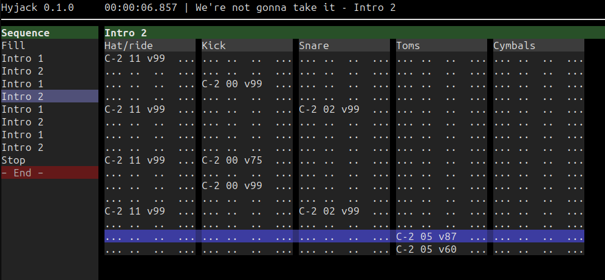
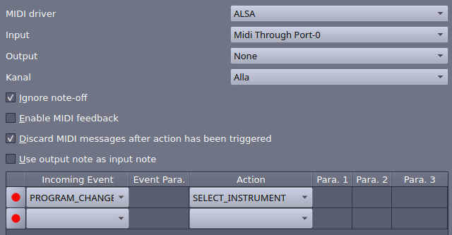
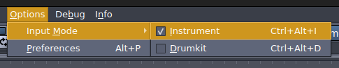

# Hyjack



Hyjack is a program for creating and playing music. It runs in the terminal and is operated entirely using the keyboard.

The UI is inspired by traditional [music trackers](https://en.wikipedia.org/wiki/Music_tracker), although it is not really a tracker under the surface. Playback relies on an external software synthesizer controlled via MIDI.

**NOTE:** *Hyjack is currently a work in progress, and many features needed for a complete editing workflow are not yet implemented.*


## A front end for Hydrogen

The motivation behind Hyjack is quite specific: to provide an efficient, keyboard-centric interface to the [Hydrogen drum machine](http://www.hydrogen-music.org/). I really like Hydrogen as an open-source, high-quality drum machine, but I prefer the editing experience of tracker programs.

My intended workflow is as follows:

  1. Edit drum (and bass) patterns in Hyjack.
  2. Enjoy live playback in Hydrogen via MIDI.
  3. When done: Convert the song to a Hydrogen song file and render an audio file in Hydrogen.

(Step (3) is still future work.)


## Hydrogen setup

This section explains how to set up Hydrogen for use with Hyjack.

Start by opening up Hydrogen's MIDI settings and check that a suitable input port is selected. The following settings have been tested to work well on Hydrogen 1.2.4 and 1.2.6 (Ubuntu 24.04).



You also need to ensure that the Input Mode is set to "Instrument". This setting is found in the Options menu.



Next, create a new song and load a drum kit. Adjust mixer settings as needed.


## Example

Start Hydrogen and load the file [GMRockKit_template.h2song](./examples/GMRockKit_template.h2song). This is an empty song with the drum kit GMRockKit loaded.

Next, start Hyjack with the file [were_not_gonna_take_it.json](./examples/were_not_gonna_take_it.json):

```bash
hyjack ./examples/were_not_gonna_take_it.json
```

You should now see a prompt that looks something like this:

```
MIDI output:
  0: Silent playback
  1: Midi Through:Midi Through Port-0 14:0
  2: Hydrogen:Hydrogen Midi-In 128:0
Select output:
█
```

Select the Hydrogen MIDI input option.

The Hyjack UI starts up, and you can press `Space` to start playing.

Alternatively, you can start with an empty song and create your own patterns. To do this, copy [GMRockKit_template.json](./examples/GMRockKit_template.json) (an empty song congigured for the GMRockKit drum kit) and start Hyjack with the copied file:

```bash
cp ./examples/GMRockKit_template.json my_song.json
hyjack my_song.json
```


## Keyboard controls

### Universal

  * `Space` – Start/stop playback
  * `Ctrl+s` – Save the song to file
  * `Ctrl+q` – Quit the application

### Pattern panel

The two upper letter rows on the keyboard correspond to notes in the following way:

```
C  C# D  D# E  F  F# G  G# A  A# B
——————————————————————————————————
   w     e        t     y     u
a     s     d  f     g     h     j
```

Pressing one of these keys when the note column is focused will insert the corresponding note.

Instrument number and velocity can be set using the number keys.

Editing:

  * `Delete` – Remove the current note
  * `Enter` – Edit the focused pattern element. Enters a mode with the following controls:
      - `Up`/`Down` – Increase/decrease value of the focused element
      - `PgUp`/`PgDown` – Increase/decrease value by a larger amount
      - `Enter`/`Esc` – Exit edit mode

Navigation:

  * `Up`/`Down`/`Left`/`Right` – Navigate to previous/next row/column in the pattern grid
  * `Ctrl+Up`/`Ctrl+Down`/`Ctrl+Left`/`Ctrl+Right` – Scroll pattern up/down/left/right
  * `Tab`/`Shift+Tab` – Navigate to the next/previous track in the same column, or the last/first column at the pattern boundary
  * `PgUp`/`PgDown` – Navigate to the first/last row of the current pattern, then previous/next pattern
  * `Home`/`End` – Navigate to the first/last column of the current pattern row
  * `Ctrl+Home`/`Ctrl+End` – Navigate to the first row of the song/last row of the song or pool
  * `F2` – Rename pattern
  * `F3` – Switch to sequence panel
  * `z`/`x`/`c`/`v` – Switch focus to editor's octave/velocity/step/instrument setting

### Sequence panel

  * `Up`/`Down` – Navigate to previous/next pattern title
  * `PgUp`/`PgDown` – Navigate to the previous/next page in the sequence
  * `Home`/`End` – Navigate to the first/last title in the sequence
  * `Ctrl+Up`/`Ctrl+Down` – Move current title up/down in the sequence list
  * `D` – Duplicate current title in the sequence list
  * `Ctrl+D` – Duplicate pattern
  * `Ins` – Insert a new pattern using the song's pattern defaults
  * `Delete` – Remove current title (moves to pool if it is the only reference)
  * `F2` – Rename pattern
  * `F4`/`Enter` – Switch to pattern panel

### Editor settings

  * `Up`/`Down` – Increase/decrease value of focused setting
  * `PgUp`/`PgDown` – Increase/decrease value by larger amount
  * `Left`/`Right` – Navigate to previous/next setting within the editor settings
  * `Home`/`End` – Set value to minimum/maximum
  * `z`/`x`/`c`/`v` – Navigate to octave/velocity/step/instrument setting
  * `Enter`/`Esc` – Exit editor settings

### Player
